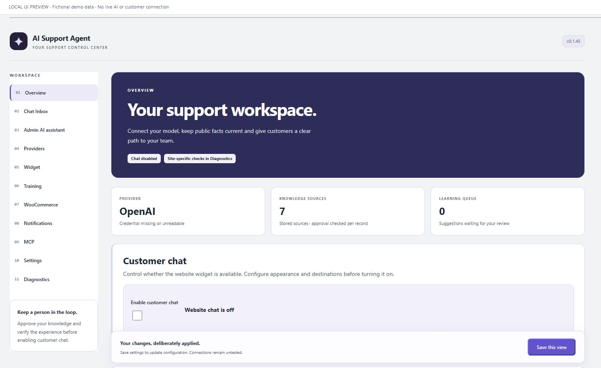
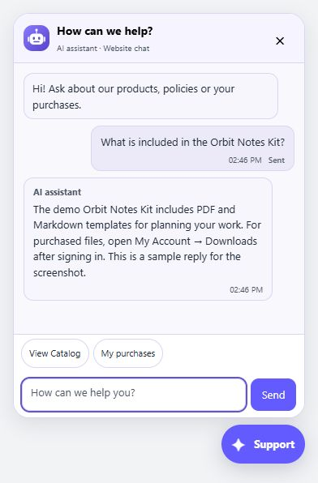
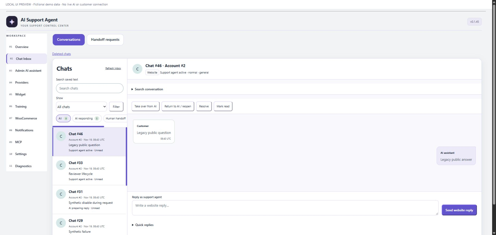
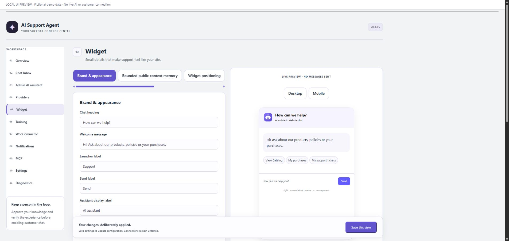

# AI Support Agent for WordPress

A lightweight, configurable website support assistant with public knowledge, WooCommerce assistance and a private human-handoff workspace.

**Version 0.1.45 · GPL-2.0-or-later · Early release.** This is the first public source release. It packages the existing 0.1.44 implementation with public setup documentation and complete license text; it does not add a new provider integration or certify a live store.

## Download and install

Download the **[installable plugin ZIP, v0.1.45](https://github.com/Aurvix/ai-support-agent/raw/refs/heads/main/releases/v0.1.45/ai-support-agent-0.1.45.zip)**. Verify its hash against [SHA256SUMS](releases/v0.1.45/SHA256SUMS). The versioned package is included in the source repository; a GitHub Release object is not required to install it. GitHub's generated source ZIP is a development checkout, not the installable plugin ZIP.

1. WordPress Admin → Plugins → Add New Plugin → Upload Plugin.
2. Select the installable plugin ZIP, install and activate it. To update an existing installation, use WordPress's replace/update flow; do not delete the plugin first.
3. Open **AI Support → Overview**. Configure Providers, Training, Widget and any support destinations before deliberately enabling customer chat.
4. Verify with fictional questions and two test customer accounts on your own staging site before a public rollout.

Updates preserve existing settings and exclusions. **Deleting the plugin removes current-site saved conversations and attributable admin chat sessions.** Configuration, approved knowledge and structured handoff records follow the existing separate full-removal opt-in. Legacy unattributed temporary caches expire separately; external-provider records and hosting backups are outside uninstall cleanup. See [data handling](docs/DATA-HANDLING.md).

## Requirements

| Component | Requirement |
| --- | --- |
| WordPress |6.5 or newer, as declared by the plugin |
| PHP |8.1 or newer; OpenSSL for encrypted saved credentials |
| HTTPS |Required for private/authenticated integration flows and public HTTPS provider endpoints |
| WooCommerce |Optional; required for catalog, purchase and native account-download features |
| AI provider |Your own authorized API/model access, or a compatible public HTTPS gateway |
| Scheduled jobs |Working WordPress cron/host scheduling for background sync and cleanup |

The disposable integration fixture pins WordPress7.1.4, WooCommerce11.2.2 and PHP8.1.34. This is evidence for that fixture, not a claim that every supported WordPress/PHP/theme combination has been tested. No Node.js dependency is required to install or run the plugin in WordPress.

## Screenshots

These are local UI previews of **v0.1.45**, using the shipped plugin assets and disposable WordPress demo markup. All accounts, product facts and conversations are fictional. The customer reply is simulated; no live model, customer or store connection was used. The previews show the Original/Light appearance; themes and branding are configurable.

### Admin overview

The support workspace brings provider status, knowledge counts and the customer-chat control together. This unconfigured demo intentionally has customer chat disabled.



### Customer chat

The floating widget includes quick actions, message bubbles, timestamps and a compact composer. This sample reply is for the interface preview only.



<details>
<summary>See the admin Chat Inbox and widget customization</summary>

### Admin Chat Inbox

The demo Inbox shows the conversation list, filters, human takeover controls and the website-reply composer. Account IDs and saved messages are synthetic test fixtures.



### Widget customization and live preview

Branding controls and the unsaved widget preview appear side by side. The preview itself does not send messages or save settings.



</details>

See [screenshot provenance](docs/screenshots/README.md) for how these documentation images were captured.

## Features

- Provider-specific model names/IDs, manual overrides, official-provider endpoints and destination-bound encrypted credentials.
- Public website/catalog reference sync, provenance, freshness and explicit exclusions. Imports and administrator teaching keep separate review controls; this is retrieval, not model-weight training.
- Bounded multi-file TXT/Markdown imports and separately manageable administrator instructions.
- Ten shared interface themes with Light/Dark, branding, positioning, sizing, a mobile icon launcher and an unsaved visual preview.
- Configurable quick actions and optional business-category question collections.
- Progressive newest-first public product cards, product-page navigation and appropriate native commerce/selection actions. No product Ask AI shortcut.
- Account-owned purchase views and navigation to native WooCommerce **My Account → Downloads**, without handing out signed file URLs in chat.
- Consent-controlled future-conversation capture, Inbox categories, administrator reply/takeover and guarded return to AI.
- Optional public-reference context memory with site/user/session isolation, limits, expiry and per-turn source rechecks.
- Outbound email, Telegram and HTTPS relay alerts, with channel-specific configuration help.

The Messenger-inspired theme is a visual preset: this plugin does **not** provide a native WhatsApp/Meta customer-chat integration. MCP is present but disabled on fresh installs; actual client interoperability is not certified by this release.

## AI provider setup

Open **AI Support → Providers**, choose a provider, enter your key privately in its password field, choose an available model and save that view. Official-provider endpoints are automatic; custom/local adapters need their own public HTTPS Chat Completions URL. Keys are encrypted in WordPress, not shipped in browser configuration. A blank key field preserves the saved value at its original destination.

| Provider choice | Obtain/setup access | Model choice |
| --- | --- | --- |
| Google Gemini |[Google AI Studio API keys](https://aistudio.google.com/apikey), [official key guidance](https://aistudio.google.com/docs/api-key) |Choose a model currently available to your project; confirm the exact ID. |
| OpenAI |[API platform](https://platform.openai.com/api-keys), [API documentation](https://developers.openai.com/api/docs/) |Use a model supporting Chat Completions; a Responses-only model is not automatically compatible. |
| NVIDIA |[NVIDIA API Catalog](https://build.nvidia.com/), [API quickstart](https://docs.api.nvidia.com/nim/docs/api-quickstart) |Hosted-model access and applicable model/trial terms depend on your account. |
| Groq |[Groq console](https://console.groq.com/keys), [quickstart](https://console.groq.com/docs/quickstart) |Use the provider's exact available model ID. |
| Compatible API / local gateway |Your separately approved gateway administrator |Supply the complete public HTTPS Chat Completions URL and exact model ID. Direct localhost/private-network URLs are not supported. |

Bundled model presets are a documentation snapshot, not live account discovery. Quotas, costs, key types and model permissions can change. Do not weaken key restrictions to work around errors; use your provider's current guidance. No trial is advertised as unlimited or as a production entitlement.

The separate **Check saved model** button submits one fixed synthetic request to the saved official connection. It can consume quota; selecting a model or opening settings sends no model request. No provider credentials or real external-provider tests are included with this release.

An illustrative, non-importable configuration is in [examples/configuration.example.json](examples/configuration.example.json). Configure credentials in WordPress privately; the plugin does not read that JSON or `.env` files.

## Knowledge, privacy and handoff

Fresh installs enable reference sync for eligible public posts/pages/products; published account/cart/checkout, private/draft/password-protected/hidden or restricted content and sensitive patterns are excluded. Existing disabled policies and explicit holds remain unchanged on upgrade. Review third-party membership/restriction behavior on your site; use explicit exclusions where needed. Public sources are untrusted reference facts, never permissions or executable instructions.

Customer chat, transcript capture, automatic chat review, memory, structured intake and MCP remain deliberate opt-ins on a fresh install. Enabling customer chat can send the question and relevant public reference text to your configured provider. Keep credentials and customer/order details out of public knowledge and instructions.

Purchase ownership is checked server-side. Linking to the account Downloads page does not make a publicly hosted file private: native WooCommerce permissions, file hosting and bearer/login policy still need site-specific verification. No refund/payment/security action is authorized by model output.

Telegram setup is under Notifications → Telegram, with BotFather and chat/channel-ID guidance. It sends outbound administrator alerts; it is not a two-way Telegram support channel. See [setup](docs/SETUP.md) and [data handling](docs/DATA-HANDLING.md).

## Development and tests

Requires Node.js24.18 or newer. The recorded local runtime is Node24.21.0. Install the pinned development dependencies with `npm ci`; they are not bundled in the plugin.

```sh
npm ci
npm test
npm run build
```

`npm test` runs the16 JavaScript/static suites with synthetic transports. Build produces the installable plugin ZIP in `dist/` and its manifest in `outputs/`.

For disposable native WordPress/WooCommerce tests, obtain the three official archives listed with SHA-256 hashes in `tests/runtime-packages.json` into the ignored `tests/runtime-cache/` folder. Windows users may run `powershell -NoProfile -File tests/fetch-runtime.ps1` under their normal execution policy; other systems can download those exact URLs and verify the listed hashes. Stop if the policy or hash check fails.

```sh
npm run build
npm run test:integration
```

The matrix runs13 profiles in HPOS/CPT modes against the exact ZIP. Its legacy-upgrade baseline is rebuilt locally from the reviewed GPL fixture source under `tests/fixtures/legacy-0.1.7/`; no private historical ZIP is needed. The fixture is for tests only, not a supported plugin release. External HTTP/email are intercepted, fixture logins are disabled and no provider key is needed. Local reports/cache/builds are ignored by Git.

Read [VALIDATION.md](VALIDATION.md) for the actual release results and limits. Isolated test principals are not proof of normal browser login or real provider, delivery, MCP-client, cron-timing, physical-device or live-store behavior.

## License and contributions

Plugin source and original SVG avatar: **GPL-2.0-or-later**. See [LICENSE](LICENSE) and [third-party inventory](THIRD_PARTY_NOTICES.md). WordPress/WooCommerce/runtime archives and npm implementation code are not redistributed in the plugin ZIP or source repository.

Use synthetic reproductions in issues. Never upload API keys, tokens, database exports, private order/download URLs or real customer chats. See [SECURITY.md](SECURITY.md) for reporting guidance. Contributions should preserve ownership checks, source freshness, secret handling and existing settings.
